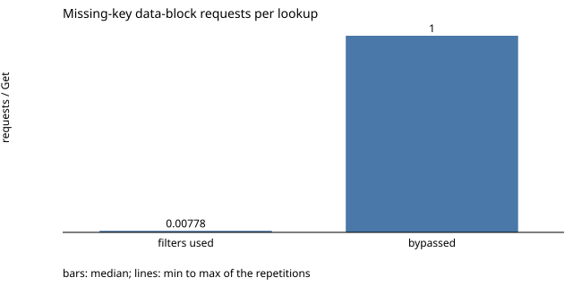

# lsm-kv-engine

[](https://github.com/cyruswu750/lsm-kv-engine/actions/workflows/ci.yml)

A crash-consistent LSM-tree key-value store in C++20, written from scratch and verified with fault
injection, differential testing, and a deterministic syscall-level crash simulator. Every `Put` and
`Delete` that returns `Ok` has been fsynced to a checksummed write-ahead log; new on-disk state is
published through a temporary file, fsync, rename and directory fsync.

- **Crash recovery:** 793 enumerated crash points across 7 workloads, each recovered under a
  process-crash model and a simulated power-loss model and checked by a response-aware oracle.
  A planted bug (a skipped SST fsync) is caught only under simulated power loss.
- **Test suite:** 534 GoogleTest cases under ASan and UBSan, including fault injection at 32 flush and
  compaction publication call sites (each with EIO and ENOSPC) and 800,000 seeded differential
  operations against a reference map on every CI run.
- **Bloom filters:** 99.2% fewer data-block requests per missing-key lookup than with filter queries
  bypassed (0.008 vs 1.000 on the benchmark's 200,000-key database), at about 1.25 bytes per key.

## Quick start
Linux, CMake 3.20+, Ninja, and GCC or Clang with C++20. GoogleTest is fetched at configure time.

```sh
cmake -S . -B build -G Ninja -DCMAKE_BUILD_TYPE=Debug -DKV_SANITIZE=ON -DBUILD_TESTING=ON
cmake --build build
ctest --test-dir build --output-on-failure --parallel "$(nproc)"
```

CI ([.github/workflows/ci.yml](.github/workflows/ci.yml)) runs exactly this configuration on every push
to `main` and every pull request. The suite is fsync-bound: run it on a real disk to exercise real
syncs (on tmpfs, fsync is effectively free).

```cpp
#include "core/db.h"

kv::Options options;                      // create_if_missing, 4 MiB memtable
std::unique_ptr<kv::DB> db;
kv::Status s = kv::DB::Open("/tmp/mydb", options, db);
if (s.ok()) s = db->Put("user:1", "alice");  // Ok = appended to the WAL and fsynced
std::string value;
if (s.ok()) s = db->Get("user:1", value);    // value == "alice"
if (s.ok()) s = db->Delete("user:1");        // a durable tombstone
```

This snippet shows the API shape; the test suites (`tests/harness/db_test.cpp` and others) exercise
the same calls.

## Architecture

```
Put/Delete ─► validate ─► [flush if memtable full] ─► [compact if run count ≥ threshold]
          ─► append WAL record ─► fsync WAL ─► apply to memtable ─► Ok

Get ─► memtable ─► flush-run SSTs, newest first ─► the one base-run SST whose key range holds the key
       (an SST is skipped without I/O if the key is outside its range or its Bloom filter says absent)
```

- **WAL:** records with separate CRC-32C checksums over the header and the payload. Recovery replays the
  complete records; an incomplete trailing record is truncated and synced before any append, while a
  checksum or field error in any complete record, including the last one, fails Open.
- **Memtable:** an ordered map of values and tombstones with sequence numbers.
- **SSTables:** 4 KiB target data blocks (a larger entry gets its own block), a sparse index, a footer, and a Bloom filter (10 bits per key), each
  with its own CRC-32C. Open validates every live SST in full; `Get` revalidates the block it reads.
- **Manifest:** one checksummed record naming the live SSTs and their runs, the active WAL, the
  checkpoint sequence and the file-ID high-water mark. It is replaced atomically, never edited.
- **Flush:** write the SST and a new empty WAL, sync and rename both, sync the directory once, publish
  the new manifest, then retire the old WAL.
- **Compaction:** a full merge of every live SST into one key-partitioned base run. Because every older
  version is an input, winning tombstones can be dropped safely.
- **Syscall seam:** every filesystem call goes through one injectable interface, which the fault
  injector and the crash simulator replace in tests.

Details: [docs/design.md](docs/design.md); byte formats and directory states:
[docs/sst-format.md](docs/sst-format.md).

## Durability contract
Guaranteed, under the filesystem's fsync contract:
- An `Ok` from `Put` or `Delete` means the record was appended and fsynced, and every file and directory
  entry it depends on was durably published. Recovery preserves it unless a later recovered mutation
  supersedes it.
- An operation that was interrupted, or that failed after persistence began, has an uncertain outcome:
  after recovery it is either completely present or absent, never partially decoded.
- A failed fsync is never retried (a later success would not prove the data reached storage). The handle
  enters `NeedsRecovery`, and every later call returns that status without I/O until the database is
  reopened.
- Open never deletes or acknowledges anything on top of a manifest whose rename might not be durable:
  it syncs the directory first (B-005, D-016).
- A checksum or field error in the WAL (only an incomplete trailing record is repaired, never a
  complete record with a bad CRC, even the last one), an SST, a filter or the manifest fails closed;
  nothing is repaired or reconstructed from a directory listing.

Not established: behavior under real power loss, device write caches, torn sector writes, writeback
reordering within a file, or media errors; no test kills a real OS process. Process crashes and power
loss are simulated by the crash simulator under the two models above, faults are injected as syscall
results, and a reopen validates only what the filesystem returns.

## How correctness is tested

| Technique | What it covers | Where |
|---|---|---|
| Byte-level truncation and mutation | the WAL cut at every byte (222 cuts), every SST byte truncated and bit-flipped, malformed manifests; never an unbounded allocation | `DBRecoveryTest.*`, `SstTest.*`, `Manifest.*` |
| Syscall fault injection | EIO, ENOSPC, EINTR, short transfers and exceptions in flush and compaction publication (each file open, write, fsync, close and rename of flush steps F1–F5 and both directory fsyncs), cleanup and recovery reads; the publication fault tests assert that each injected fault was reached | `DBFaultTest.*`, `PublishFaultTest.*`, `CompactionFaultTest.*`, `UnsyncedManifestTest.*` |
| Crash simulator | 793 crash points × 2 models = 1,586 recoveries, judged by a response-aware oracle | `Workloads/CrashMatrixTest.*` |
| Mutation check | a skipped SST fsync must be caught under simulated power loss and only there | `Workloads/CrashMutationTest.*` |
| Differential testing | 8 workloads × 20 seeds × 5,000 operations with reopens, flushes, multi-output compactions and mixed filter versions | `Seeds/DifferentialTest.*` |

Every check, its expected result and its regression test: [docs/failure-matrix.md](docs/failure-matrix.md).

## Bugs found
Seven defects were found during development and each is pinned by a regression test
([docs/BUGLOG.md](docs/BUGLOG.md)). Three examples:
- **B-005:** Open deleted the old WAL and acknowledged writes on a manifest whose directory fsync had
  never completed; under power loss the directory could revert to a generation whose WAL was gone.
- **B-006:** a crafted SST footer could declare a 256 MiB index in a sparse file and force a huge
  allocation before being rejected; the format now bounds the index before reading it.
- **B-002:** a corrupt WAL record with a truncated payload was classified as a torn tail and would have
  been silently truncated instead of failing closed.

## Performance
Local measurements from [bench/results/summary.md](bench/results/summary.md): median [min, max] of 3
runs, warm page cache, 16-byte keys and 100-byte values, seed 42; raw data in `bench/results/raw/`.
Environment: AMD Ryzen 9 7945HX (32 logical CPUs), 7.9 GB RAM visible to WSL2, ext4 on a WSL2 virtual
disk, GCC 15.2 `-O3`, sanitizers off. They were measured on the pre-integration M4 snapshot named in
`bench/results/environment.txt`, whose engine and benchmark driver differ from the committed code
only in source comments, and were not re-measured on the commits. Request counts are engine requests,
not device reads; latencies are per call and include about 20 ns of clock overhead.

| Experiment | Configuration | Result |
|---|---|---|
| 1. Synchronous inserts | 20,000 random `Put`s, 64 KiB memtable, run threshold 4 | 217 [159, 219] ops/s; p50 4.48 ms, p99 5.97 ms, max 105 ms (flush and compaction included) |
| 1. Reads | 200,000 keys, 50,000 lookups each, filters on | existing p50 12.1 µs, p99 20.8 µs; missing p50 0.14 µs, p99 0.38 µs |
| 2. Sync bypass (unsafe reference) | same insert trace, every fsync skipped | 78,229 ops/s (about 360×); the gap is a sync-policy effect, not an exact fsync time share |
| 3. Bloom on vs bypassed | same files, same missing-key trace (inside the key range) | data-block requests per lookup 0.008 vs 1.000 (−99.2%); bytes requested 31 vs 3,998; p50 0.14 vs 12.04 µs |
| 4. Run threshold 2 / 4 / 8 / off | same trace (20,000 ops over 10,000 keys, 10% deletes), same end | write amplification 16.06 / 6.95 / 4.20 / 2.42; DB bytes 1.06 / 1.11 / 1.32 / 2.45 MB; SST candidates per lookup 1.0 / 1.9 / 5.3 / 18.2; max insert latency 102 / 99 / 102 / 59 ms (see the caveat below) |



Trade-offs: Bloom filters remove nearly all data-block requests for missing keys at about 1.25 bytes
per key (here the read database had compacted to one SST, so each lookup saved one block). Lower
thresholds cut lookup candidates and database size but rewrite all live data more often. Caveat for
group 4 latencies: synchronous latency changed with time during the run (insert p50 about 4.5 ms in the
first two threshold runs and 6.6–7.0 ms in all later ones, in every configuration; cause not measured),
so group 4 throughput and latencies, including the lower maximum without compaction, cannot establish
the causal effect of the threshold on latency ([NOTES.md](bench/results/NOTES.md)).

Reproduce:

```sh
cmake -S . -B build-bench -G Ninja -DCMAKE_BUILD_TYPE=Release -DKV_SANITIZE=OFF -DBUILD_TESTING=OFF -DKV_BUILD_BENCH=ON
cmake --build build-bench
scripts/run_benchmarks.sh build-bench/bench/kv_bench <data dir> <results dir>
scripts/summarize_bench.py <results dir>
```

## Key design decisions
- [D-008](docs/decisions.md): replace the manifest as one whole-file record rather than an edit log.
- [D-012](docs/decisions.md): the publication order, and separate error classes for cleanup after
  publication.
- [D-016](docs/decisions.md): Open syncs the directory before retiring files or acknowledging writes.
- [D-017](docs/decisions.md): full compaction of every live SST, trading write amplification for a simple
  tombstone-safety argument.
- [D-028](docs/decisions.md): a damaged Bloom filter fails Open; a filter is never trusted unchecked.

All 30 decisions, with alternatives and costs: [docs/decisions.md](docs/decisions.md).

## Limitations
- One process and one calling thread; the lock is advisory.
- Flush and compaction run in the foreground inside the `Put` or `Delete` that triggers them, and every
  compaction rewrites all live data.
- Open reads every live SST in full to validate it, so startup I/O grows with the data size.
- Recovery reads the whole active WAL into memory.
- No range scans, snapshots, transactions or compression.
- No migration from databases written by earlier engine versions (`v0.1-m1`, `v0.2-m2`); they are
  rejected with `UnsupportedFormat` and left unchanged.
- A crash during the very first initialization can leave residue that Open reports as `Corruption`; it
  needs manual cleanup or a fresh directory.
- Each open SST keeps its Bloom filter in memory (about 1.25 bytes per key at the default).
- Symbolic links are never followed: a symlinked database directory, `LOCK` or WAL is rejected.
- Per-SST and per-database size limits (block count, index size, filter keys, manifest entries) are
  documented in [docs/sst-format.md](docs/sst-format.md) (sections 3.6, 3.7, 4 and 6); a flush or
  compaction that would exceed them fails without losing acknowledged data.

## Layout
```
src/core/      engine: WAL, memtable, SST, Bloom filter, manifest, compaction, POSIX I/O, DB
src/testing/   test-only helpers: independent WAL/SST/manifest builders, fault-injecting syscalls,
               crash simulator
tests/harness/ GoogleTest suites
bench/         benchmark driver and recorded results
scripts/       benchmark runner and summary, longer differential runs, Bloom reference vectors
docs/          design, on-disk format, compaction and crash simulator, filters and benchmarks,
               decisions, bug log, failure matrix
```

## References
- LevelDB implementation notes: https://github.com/google/leveldb/blob/main/doc/impl.md
- Linux `fsync(2)`: https://man7.org/linux/man-pages/man2/fsync.2.html

## License
MIT; see [LICENSE](LICENSE).
